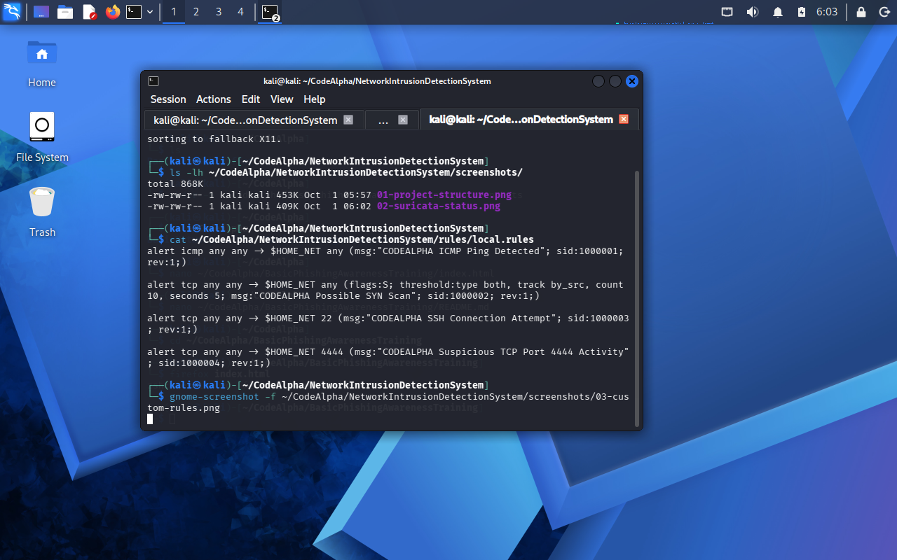
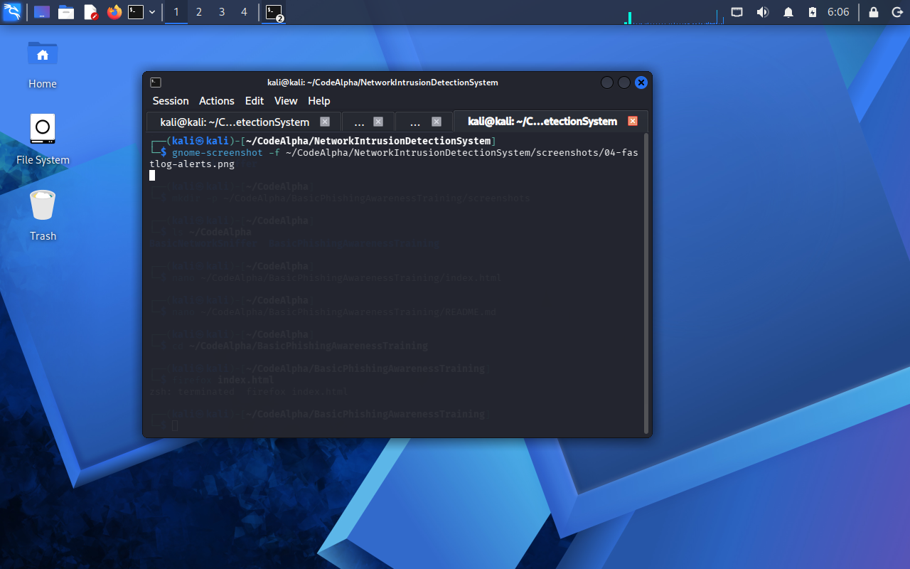
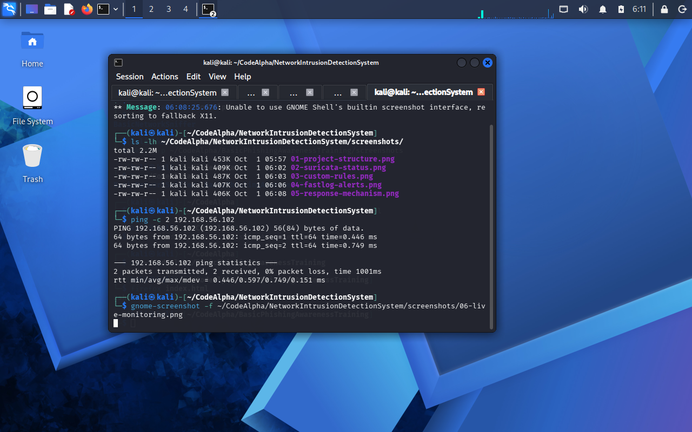

# Network Intrusion Detection System (Suricata)

A reproducible **Network Intrusion Detection System (NIDS)** learning lab using **Suricata** on Ubuntu Server and controlled traffic from Kali Linux. The supplied rules detect test ICMP, TCP SYN bursts, destination-port-22 traffic, and destination-port-4444 traffic. Logs and scripts demonstrate basic alert analysis and optional human-approved firewall response.

> **Environment:** Linux VMs on a private VirtualBox network. **Do not scan or block systems you do not own or have authorization to test.**

## Project objectives

1. Install and configure Suricata on a fresh Ubuntu Server VM.
2. Configure the protected subnet and the correct capture interface.
3. Load and validate the four provided local detection rules.
4. Generate safe, authorized traffic from Kali to Ubuntu.
5. Verify rule matches in `fast.log`, then monitor alerts continuously.
6. Optionally review a suspicious source and select a manual response.

## What to install — prerequisites

| Where | Required software | Why |
| --- | --- | --- |
| **Host PC/laptop** | [VirtualBox](https://www.virtualbox.org/wiki/Downloads) | Runs the two isolated VMs |
| **VM 1: Ubuntu Server** | [Ubuntu Server ISO](https://ubuntu.com/download/server), `suricata`, `git`, `iproute2` | Receives test traffic and runs the IDS |
| **VM 2: Kali Linux** | [Kali VM/ISO](https://www.kali.org/get-kali/), `ping`, `nmap`, `netcat` (optional) | Generates authorized test traffic |
| **Ubuntu VM (optional)** | `ufw`, `tcpdump`, `jq` | Manual firewall response, packet visibility, JSON inspection |

**Suggested resource allocation:** Ubuntu VM ~2 GB RAM / 20 GB disk; Kali VM ~3–4 GB RAM / 20–30 GB disk. For comfortable concurrent use, ~16 GB host RAM and ~40–60 GB free disk are recommended. These are estimates, not verified platform minimums.

## Lab diagram

```text
Host laptop/desktop — VirtualBox
         |
         +-- VM 1: Ubuntu Server (Suricata IDS / test target)
         |       Example lab IP: 192.168.56.102/24
         |       Example lab interface: enp0s8
         |
         +-- VM 2: Kali Linux (test traffic generator)
                 Example lab IP: 192.168.56.103/24

VirtualBox Adapter 1 = NAT (optional internet access for installing tools)
VirtualBox Adapter 2 = Host-only (both VMs on one isolated lab subnet)
```

The IP addresses/interface names shown are from the original lab; **your actual configuration may differ**. This is **host-based visibility of traffic addressed to Ubuntu's lab interface**. Host-only networking does not automatically make an Ubuntu VM a passive network tap for unrelated VM-to-VM traffic.

## Setup from a fresh PC or laptop

### Step 1 — Prepare VirtualBox on the host (one time)

1. Install VirtualBox using the [official download](https://www.virtualbox.org/wiki/Downloads) appropriate to your host operating system.
2. Create/import two guests: **Ubuntu Server** and **Kali Linux**.
3. Shut down both VMs. Under **Settings > Network** for each VM:
   - **Adapter 1:** Enable, **NAT** (for `apt` downloads).
   - **Adapter 2:** Enable, **Host-only Adapter** (or Host-only Network in newer UI), select the **same host-only network** for both.
4. Configure the host-only network in VirtualBox Network Manager. For automatic IP allocation, enable its DHCP server; alternatively configure nonconflicting static addresses yourself.
5. Start the VMs and inspect their addresses using the commands below.

See [Oracle's host-only networking documentation](https://docs.oracle.com/en/virtualization/virtualbox/7.2/user/networkingdetails.html) for UI and network-mode differences across versions.

### Step 2 — Verify VM network connectivity

**On Ubuntu Server:**

```bash
ip -br -4 addr
ip route
```

**On Kali:**

```bash
ip -br -4 addr
```

Locate the adapters on your private subnet. Do not assume `enp0s8`, `eth1`, or any IP will match the screenshot. When VirtualBox DHCP is enabled, use its **actual assigned addresses**, which may not be `192.168.56.102` and `.103`.

**Only if host-only DHCP is disabled or unavailable**, and after verifying unused addresses/interface names, temporary lab configuration may look like this:

Ubuntu Server (replace `enp0s8` with the *correct host-only interface*):

```bash
sudo ip link set enp0s8 up
sudo ip address add 192.168.56.102/24 dev enp0s8
```

Kali (replace `eth1` with its *correct host-only interface*):

```bash
sudo ip link set eth1 up
sudo ip address add 192.168.56.103/24 dev eth1
ping -c 3 192.168.56.102
```

**Do not** run these example static-IP commands against an interface already configured by DHCP, and do not change the NAT interface. `ip address add` is temporary and will not survive VM reboot; for permanent static networking, configure the guest OS's network manager or Ubuntu Netplan. A failed ping may also reflect guest firewall restrictions.

### Step 3 — Install necessary software (in the correct VM)

**Inside Ubuntu Server** (the IDS VM):

```bash
sudo apt update
sudo apt install -y git suricata iproute2 iputils-ping tcpdump
suricata --build-info | head -n 15
```

**Inside Kali Linux** (the test VM):

```bash
sudo apt update
sudo apt install -y iputils-ping nmap netcat-openbsd
```

Ubuntu's `apt` packages are adequate for this educational example. Newer Suricata releases may also be available from the [OISF stable PPA](https://docs.suricata.io/en/latest/install/ubuntu.html), but adding third-party package repositories is **not required** to follow this lab.

### Step 4 — Download the project onto Ubuntu

**Inside Ubuntu Server** (not only on your host PC):

```bash
git clone https://github.com/mdalamin-infosec/Security-Labs.git
cd Security-Labs/NetworkIntrusionDetectionSystem
ls rules/local.rules scripts/monitor_alerts.sh scripts/response.sh
```

If you already cloned the repository in Ubuntu, skip the `git clone` command and `cd` to its local location. All following relative paths assume your working directory is **`NetworkIntrusionDetectionSystem/`**.

### Step 5 — Install custom rules and edit Suricata settings

```bash
sudo install -d -m 755 /etc/suricata/rules
sudo install -m 644 rules/local.rules /etc/suricata/rules/local.rules
sudo cp /etc/suricata/suricata.yaml /etc/suricata/suricata.yaml.bak
sudo nano /etc/suricata/suricata.yaml
```

In `/etc/suricata/suricata.yaml`, find the **existing** keys/sections. Adjust them; **do not append duplicate top-level YAML sections**.

1. Set `HOME_NET` under `vars.address-groups` to the host-only test subnet (example only):

   ```yaml
   HOME_NET: "[192.168.56.0/24]"
   ```

2. Under the **existing** `rule-files:` list, add the absolute local-rule file path while retaining any existing rules you want:

   ```yaml
   rule-files:
     - suricata.rules
     - /etc/suricata/rules/local.rules
   ```

   **Note:** Some package installations do not contain `suricata.rules` yet. If it is absent, either remove that entry until you fetch it or run `sudo suricata-update` (where installed). The provided four custom rules work without the community ruleset.

3. Under the **existing** `af-packet:` section, change the active capture `interface:` to your real Ubuntu host-only interface (`enp0s8` in the example). Preserve the other working interface settings. Example:

   ```yaml
   af-packet:
     - interface: enp0s8
       cluster-id: 99
       cluster-type: cluster_flow
       defrag: yes
   ```

   Your distribution's systemd service must actually be using the intended packet-capture mode; if not, inspect `systemctl cat suricata` and the package-specific service setup. See the [Suricata quickstart](https://docs.suricata.io/en/latest/quickstart.html).

4. Check that **`fast` logging is enabled** in the outputs configuration (normally under `outputs:`). The supplied scripts depend on `/var/log/suricata/fast.log`. If your config disables fast logging, enable that output **within the existing outputs list**.

The `CODEALPHA` string found in the original rules is just an **alert message marker** used by the supplied Bash scripts. This lab does not require a separate CodeAlpha repository. If you rename the marker, update **both** monitor/response scripts accordingly.

### Step 6 — Check the configuration and start the IDS

**Inside Ubuntu Server:**

```bash
sudo suricata -T -c /etc/suricata/suricata.yaml
sudo systemctl enable --now suricata
sudo systemctl restart suricata
sudo systemctl status suricata --no-pager
sudo tail -n 25 /var/log/suricata/suricata.log
```

`suricata -T` must succeed. If it fails, read the error and correct the YAML/rule syntax **before proceeding**. Do not start a second packet-capture instance on the same interface merely to test the service.

### Step 7 — Generate lab traffic and confirm alerts

**In Ubuntu, terminal A** (watch logs):

```bash
sudo tail -Fn0 /var/log/suricata/fast.log
```

**In Kali** (replace the destination with your Ubuntu lab IP):

```bash
ping -c 3 192.168.56.102
nmap -sT -Pn -p 22,4444 192.168.56.102
```

For a controlled SYN-burst detection check **only against your Ubuntu lab VM**:

```bash
sudo nmap -sS -Pn -p 1-40 192.168.56.102
```

Expected examples: rule SID `1000001` for ICMP and potentially SIDs `1000002`, `1000003`, and `1000004` for matching TCP traffic. The SYN threshold rule counts **10 matching SYN packets within 5 seconds per source**; whether a particular scan triggers it depends on timing and packet visibility. A failed TCP connection can still generate a matching SYN packet.

**In Ubuntu, terminal B** (scripted monitor):

```bash
cd ~/Security-Labs/NetworkIntrusionDetectionSystem
bash scripts/monitor_alerts.sh
```

The script prints only log lines containing `CODEALPHA`. Use `Ctrl+C` to stop. If your clone is somewhere else, change the directory accordingly.

### Step 8 — Optional human-approved response (lab only)

The response script looks for the newest `CODEALPHA Possible SYN Scan` alert and extracts a source IP. It offers **log-only** or **UFW deny**. The original script contains a small hard-coded self-protection list and is **not suitable for automatic production blocking**.

```bash
# Only if you intend to test the optional UFW action:
sudo apt install -y ufw
sudo ufw status
bash scripts/response.sh
```

**Choose `1` (log only) unless you have intentionally prepared a safe firewall test.** UFW may be inactive, in which case `ufw deny` records a rule but does not provide enforcement. Do **not** enable UFW blindly over SSH—you may lose remote access. The script also reports a "blocked" action without validating that UFW is active or the rule works.

If you added a lab rule, review and remove it safely:

```bash
sudo ufw status numbered
# After reviewing the number, e.g. 3:
# sudo ufw delete 3
```

## Project files

```text
NetworkIntrusionDetectionSystem/
├── README.md
├── rules/local.rules                 # Four custom Suricata signatures
├── scripts/monitor_alerts.sh       # Prints matching fast.log events
├── scripts/response.sh             # Optional manual log/block prompt
├── reports/detection_report.md     # Original lab evidence notes
└── screenshots/
    ├── 01-project-structure.png
    ├── 02-suricata-status.png
    ├── 03-custom-rules.png
    ├── 04-fastlog-alerts.png
    ├── 05-response-mechanism.png
    └── 06-live-monitoring.png
```

## Detection rule summary

| SID | Matches | Interpretation | False-positive risk |
| --- | --- | --- | --- |
| `1000001` | ICMP to `$HOME_NET` | Ping / ICMP test packet | High; many normal ICMP uses |
| `1000002` | Multiple TCP SYN packets (threshold) | Possible port scan | Moderate; bursts can be legitimate |
| `1000003` | TCP to port 22 | SSH connection attempt | High; normal administrator connections |
| `1000004` | TCP to port 4444 | Traffic to chosen lab test port | High; port number alone proves little |

## Troubleshooting — common issues

| Problem | What to check |
| --- | --- |
| `git clone` fails | Internet/NAT adapter, Git installed, correct repository URL and access permissions |
| Kali cannot reach Ubuntu | Both Adapter 2 connections use the same host-only network, correct guest IP/subnet, interface UP, firewall |
| `suricata -T` reports bad rules | YAML indentation, exact `local.rules` path, syntax error, missing `suricata.rules` |
| Service runs but no alerts | `af-packet` interface is the actual test interface, packets are addressed to Ubuntu, `HOME_NET` includes subnet, rule loaded |
| `fast.log` missing/empty | Check `outputs`/fast logging, `/var/log/suricata/suricata.log`, `sudo journalctl -u suricata -n 60 --no-pager` |
| Script prints nothing but log has other alerts | Filter matches only `CODEALPHA` rule messages |
| UFW denies have no effect | `sudo ufw status` may show inactive; do not enable remotely without a recovery path |

Optional direct packet visibility check on Ubuntu:

```bash
sudo tcpdump -ni enp0s8 icmp
```

Replace `enp0s8` with the real interface. If `tcpdump` cannot see a Kali ping addressed to Ubuntu, fix VM networking before debugging Suricata rules.

## Evidence and report






Additional screenshots are in [`screenshots/`](screenshots/). See the original [detection report](reports/detection_report.md).

## Limitations and next steps

- This configuration observes packets delivered to the Ubuntu VM's monitored interface, not every packet on the host-only switch.
- Static signatures can miss threats and trigger on benign activity. Correlate multiple facts before taking action.
- The UFW response script is manual, parses a fragile text log format, and does not reliably confirm enforcement.
- For a production-grade project, add structured `eve.json` parsing, automated safe tests, version-pinned configuration, configuration-as-code, alert triage, and controlled response approvals.

**Official references:** [Suricata quickstart](https://docs.suricata.io/en/latest/quickstart.html) · [Suricata rule-files configuration](https://docs.suricata.io/en/latest/configuration/suricata-yaml.html) · [VirtualBox networking](https://docs.oracle.com/en/virtualization/virtualbox/7.2/user/networkingdetails.html)
