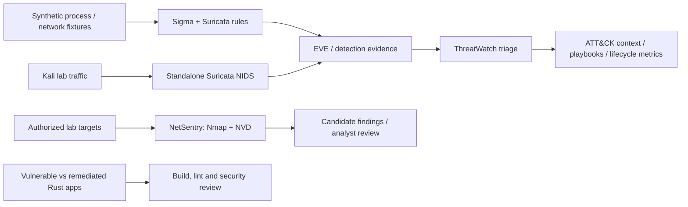

# Portfolio architecture

The repository is a collection of related defensive-security labs rather than one monolithic application.

## Design themes

- **Explicit scope:** active traffic generation and scanning are constrained to authorized lab systems.
- **Evidence separation:** synthetic, real-engine, controlled live-lab and unmeasured claims are documented separately.
- **Machine-readable results:** metrics are derived from JSON/CSV/EVE where practical rather than screenshots alone.
- **Local raw evidence:** runtime outputs remain ignored until sanitized.
- **Independent CI:** committed source/fixture paths are rechecked in GitHub Actions without depending on the owner's private VM topology.

## Project boundaries

| Project | Primary responsibility | Does not claim |
| --- | --- | --- |
| Sigma + Suricata | Detection-rule development and replay | Production detection efficacy |
| Standalone NIDS | Live packet visibility and four custom signals | Live benign FPR or compromise confirmation |
| ThreatWatch | Correlation, prioritization and investigation workflow | Enterprise SOC productivity |
| NetSentry | Scoped inventory and CVE candidate enrichment | Confirmed exploitability |
| Secure code review | Source/build/lint comparison | Complete application remediation |
