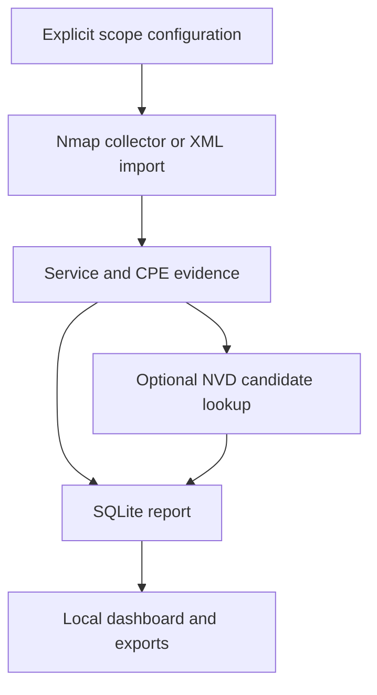

# Scoped vulnerability-assessment lab

## Objective
Collect an explicitly authorized private IPv4 service inventory with Nmap,
enrich eligible application CPEs with NVD CVE candidates, and review priorities
in a local dashboard. This is a small lab workflow, not a validated enterprise
vulnerability-management platform.

## Architecture


## Environment
| Component | Recorded status |
| --- | --- |
| Cleanup runtime | Ubuntu 24.04.3 LTS; Python 3.12.14 |
| Direct dependencies used | Flask 3.1.3, defusedxml 0.7.1, Waitress 3.0.2 |
| Supported Python declaration | 3.11 or newer; other CI matrix versions not executed locally |
| Offline demo | Requires neither Nmap nor NVD access |
| Live Nmap/NVD/browser checks | TODO: test and record actual tool versions |

## Setup
```bash
git clone https://github.com/mdalamin-infosec/Security-Labs.git
cd Security-Labs/enterprise-vulnerability-scanner
python3 -m venv .venv
. .venv/bin/activate
python -m pip install -r requirements.txt -e .
```

## How to run
Offline synthetic demonstration:
```bash
python -m netsentry demo --db outputs/demo.sqlite3
python -m netsentry serve --db outputs/demo.sqlite3
```
Open [the local dashboard](http://127.0.0.1:8080). Stop with Ctrl+C.
The demo is explicitly marked `demo: true`.

```bash
python -m netsentry export --db outputs/demo.sqlite3 --output outputs/demo-report.json
```

For a live **authorized lab scope**, install Nmap, copy
[the scope example](configs/lab.example.json) to `configs/lab.json` and edit
every target/allowlist to your actual approved machines before running:
```bash
python -m netsentry scan --config configs/lab.json --db outputs/lab.sqlite3 --raw-dir outputs/raw
```
Add `--enrich` only when requesting live NVD lookups. Keep an optional
`NVD_API_KEY` in the environment. The program accepts literal private/loopback
IPv4 targets, not DNS names or public targets. Scanning sends active probes.

## How I validated it
```bash
python -m unittest discover -s tests -v
python -m pip check
```
The [actual 34-test run](docs/validation-run.txt) exercises scope validation,
XML parsing, mocked NVD success/failure/pagination, report counting, export
handling and Flask test-client behavior. Network errors are simulated in those
tests; their success does not validate the live API.

The built wheel was installed into a separate environment and used outside the
checkout. Packaged fixtures/templates/static assets were accessible, and six
HTTP test-client routes returned 200; see [packaging evidence](../docs/packaging-run.txt).
This was not a real-browser session. [Validation details](docs/VALIDATION.md)
separate current checks from pending live work.

## Results
| Check | Recorded result |
| --- | --- |
| Unit tests | 34 passed |
| Synthetic demo/export | 4 hosts, 8 services, 4 unique example CVEs, 6 endpoint CVE instances, 3 service reviews; `demo: true` retained |
| Installed package | Demo, template and static resources worked outside the source directory |
| Confirmed applicable vulnerabilities on real targets | TODO: measure |
| Live Nmap/NVD and browser UI behavior | TODO: test |

The [example report](sample-data/example-report.json) is synthetic. Its CVSS
values and CVE relationships are curated fixture inputs, not current
vulnerability findings or an official NVD snapshot.

## Limitations
A version/CPE match is only a candidate. Backports, prerequisites and compound
applicability require analyst/vendor checks. Missing/failed lookups remain
coverage gaps. The custom priority formula is not CVSS and is not a calibrated
risk probability. There is no credentialed assessment, exploit validation,
asset discovery at enterprise scale, or authenticated multi-user dashboard.
Empty demo lookups do not establish a secure service.

## MITRE ATT&CK mapping
| Activity | Relationship | Boundary |
| --- | --- | --- |
| Nmap service inventory | [T1046: Network Service Discovery](https://attack.mitre.org/techniques/T1046/) | The tool performs authorized discovery; it does not detect all discovery activity |
| Public-facing application CVE triage | [T1190](https://attack.mitre.org/techniques/T1190/) risk context | A CVE candidate does not establish exploitation or technique coverage |
| Business priority / remediation review | No direct ATT&CK technique assigned | Defensive workflow, not an adversary behavior |

## References
- [Nmap version detection](https://nmap.org/book/vscan.html).
- [NVD API 2.0](https://nvd.nist.gov/developers/vulnerabilities).
- [FIRST CVSS guidance](https://www.first.org/cvss/).
- [Assessment methodology](docs/ASSESSMENT_METHODOLOGY.md),
  [data model](docs/DATA_MODEL.md), [operating guide](docs/OPERATIONS_RUNBOOK.md).
- [Personal TODOs](../docs/TODO.md) and [interview questions](../docs/INTERVIEW_QUESTIONS.md).
