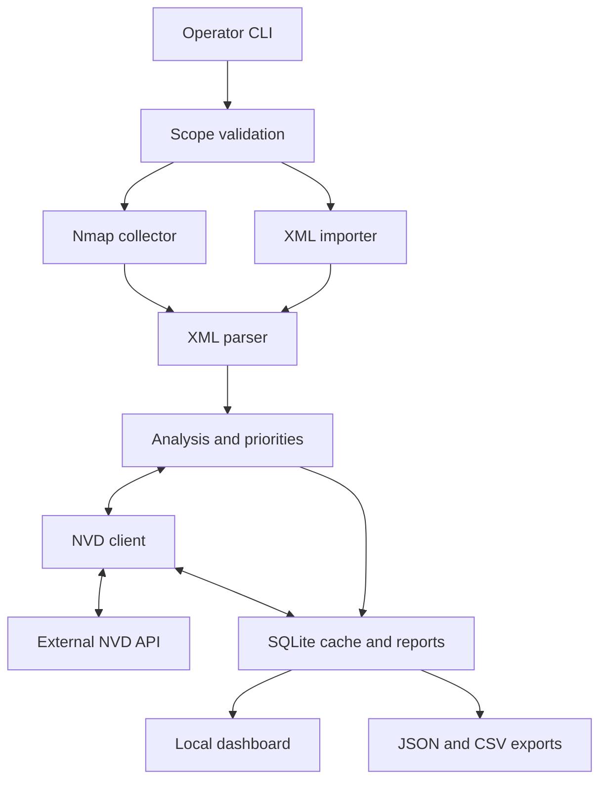

# System Architecture and Security Boundaries

| Document control | Value |
| --- | --- |
| Identifier | NS-ARCH-001 |
| Revision | 1.1 |
| Applies to | NetSentry Lab 1.0.0 |
| Updated | 2026-10-14 |
| Audience | Security engineers, operators, and code reviewers |

## 1. Deployment model

NetSentry runs on a single operator workstation. The CLI performs collection and analysis. A local Flask application reads stored reports and is served through Waitress on `127.0.0.1`. The browser does not initiate scans or submit configuration changes.

Nmap is an external executable resolved from the operator's environment. NVD is an external HTTPS service used when enrichment is requested. SQLite stores report snapshots and successful CVE lookups.

## 2. Component responsibilities

| Component | Responsibility | Boundary |
| --- | --- | --- |
| [config.py](../src/netsentry/config.py) | Validate target literals, allowlists, port syntax, and asset context | Operator-supplied configuration |
| [scanner.py](../src/netsentry/scanner.py) | Build Nmap arguments, enforce collector timeout, and parse XML | External executable and network evidence |
| [nvd.py](../src/netsentry/nvd.py) | Query, normalize, retry, paginate, and cache CVE data | External HTTPS responses |
| [analysis.py](../src/netsentry/analysis.py) | Assemble findings, coverage, notes, and report identifiers | Correlation and report construction |
| [risk.py](../src/netsentry/risk.py) | Apply authored review policies and priority calculations | Project policy decisions |
| [storage.py](../src/netsentry/storage.py) | Persist snapshots and cache entries through parameterized SQL | Local SQLite database |
| [web.py](../src/netsentry/web.py) | Serve read-only views, API responses, and downloads | Local browser interface |
| [exports.py](../src/netsentry/exports.py) | Serialize JSON and protect CSV cells from formula prefixes | Downstream reporting tools |
| [demo.py](../src/netsentry/demo.py) | Load synthetic fixtures through an isolated demo provider | Demonstration data only |

## 3. Configuration contract

| Field | Type / accepted values | Default or constraint |
| --- | --- | --- |
| `name` | String | 1–100 characters; default `Authorized lab` |
| `allowed_cidrs` | Array of strict IPv4 CIDRs | Required; 1–16 entries wholly inside RFC1918 or loopback ranges |
| `max_hosts` | Integer | Default 4; range 1–16 |
| `ports` | Comma-separated ports or ascending ranges | Port numbers 1–65535; at most 2,048 characters |
| `scan_timeout_seconds` | Integer | Default 900; range 30–3,600 |
| `targets` | Array of target objects | Required; 1–`max_hosts` unique explicit addresses |
| `targets[].ip` | Literal IPv4 address | Must be in an allowed CIDR; network/broadcast addresses rejected for prefixes below /31 |
| `targets[].name` | String | 1–100 characters; defaults to the IP address |
| `targets[].criticality` | Integer | Default 3; range 1–5 |
| `targets[].exposure` | `internal`, `dmz`, or `external` | Default `internal`; declared context |

If `ports` is omitted, the code default is `21,22,23,80,443,445,3306,3389,5432,8080`. The distributed [example configuration](../configs/lab.example.json) explicitly supplies a larger list. An allowlist does not expand into a subnet scan: only entries in `targets` become Nmap targets.

## 4. Trust boundaries

| Boundary | Data exchanged | Implemented control | Residual consideration |
| --- | --- | --- | --- |
| Operator → configuration loader | Scope and asset context | Type, range, CIDR, and syntax validation | Validation cannot establish ownership or authorization |
| Python → Nmap | Validated argument list | `shell=False`, literal targets, fixed flags, collector timeout | Installed Nmap binary/data files remain trusted dependencies |
| Targets → XML parser | Service evidence | 10 MiB input cap, target checks, entity/external-reference protection | Banners may be incomplete or misleading |
| Client → NVD | Application CPE, pagination flags, optional key header | Fixed HTTPS endpoint; bounded requests | Product identity is disclosed externally; target IPs are not lookup parameters |
| NVD → analysis | CVE metadata and metrics | Response cap, structural checks, rejected-record filtering, complete-page caching | Record completeness/applicability can change |
| SQLite → browser | Report content | Escaped templates, trusted-host checks, restrictive response headers | Local users with database access can read inventory |
| Report → spreadsheet | Finding cells | Formula-prefix escaping | JSON retains the complete assessment record |

## 5. Persistence and concurrency

Each database operation opens a connection, uses a transaction where appropriate, and closes the connection afterward. SQL is parameterized. The application does not migrate report payloads across schema versions.

The cache is keyed by normalized CPE and is shared by reports using the same database. Successful complete lookups remain reusable for 24 hours. Separate CLI processes do not coordinate NVD rate limits; operate one enrichment process per shared public IP/API key at a time.

New database files use mode `0600`. New data directories request mode `0700`; existing permissions are retained. Raw XML and exports follow the process umask. The [runbook](OPERATIONS_RUNBOOK.md) sets a restrictive umask for operational evidence.

## 6. Deployment limitations

The application has no remote authentication, RBAC, transport termination, or tenant isolation. Trusted-host validation is a request check, not authentication. The local API is read-only, and collection remains a CLI action.

The collector timeout applies to Nmap. Enrichment has per-request timeouts and bounded retries but no global assessment deadline. Many eligible CPEs can extend total runtime beyond the collector timeout.

Credentialed assessment, exploit verification, live UDP scanning, scheduling, and workflow-state persistence remain outside the implemented scope.
