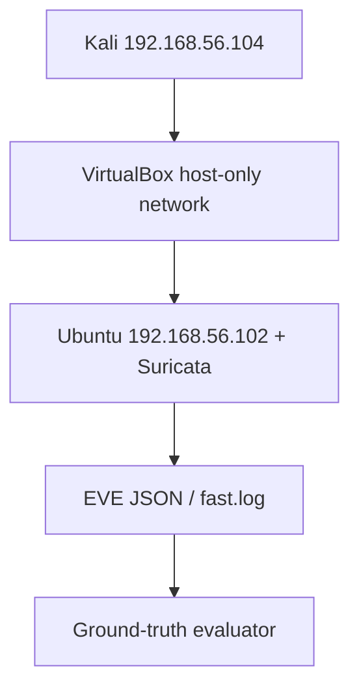

# Network intrusion detection with Suricata

## Objective

Observe traffic sent to a monitored Linux lab target, apply four custom rules, and practice evidence-based alert review. An alert is a rule match; it does not establish compromise.

## Architecture



## Current validated evidence

| Check | Result |
| --- | --- |
| Shell syntax | 2 scripts passed `bash -n` |
| Rule inventory | SIDs 1000001–1000004 |
| Live attack cohort | 4/4 controlled scenarios detected; TP=4, FN=0 |
| Live benign cohort / FPR | Not yet measured |

The live run used the isolated Kali-to-Ubuntu host-only path. Evidence was retained locally as EVE JSON, ground truth, rules/configuration and computed metrics.

## Four live cases

- SID 1000001 — ICMP traffic
- SID 1000002 — SYN threshold
- SID 1000003 — TCP/22
- SID 1000004 — TCP/4444

The result applies only to these controlled cases. In particular, a ping, port 22 or port 4444 is not inherently malicious.

## Setup and run

On the authorized Ubuntu target, set `HOME_NET` and the host-only interface, validate configuration, then run Suricata in the foreground:

```bash
sudo suricata -T -c configs/suricata-lab.yaml -S rules/local.rules -l outputs/config-check
sudo suricata -i "$LAB_IFACE" -c configs/suricata-lab.yaml -S rules/local.rules -l outputs/live
```

On the Kali VM, reproduce only inside the isolated lab. The exact cases and evidence fields are documented in [docs/VALIDATION.md](docs/VALIDATION.md).

## Limitations

- The current live cohort has no labeled benign sessions, so live FPR is not available.
- ICMP and SSH rules are intentionally broad learning signals.
- The SYN rule counts packets by source, not distinct destination ports.
- Optional response logic is not evidence of successful containment and should remain manual in a disposable lab.

See the [benign cohort plan](docs/BENIGN_COHORT_PLAN.md) and root [roadmap](../docs/ROADMAP.md).
