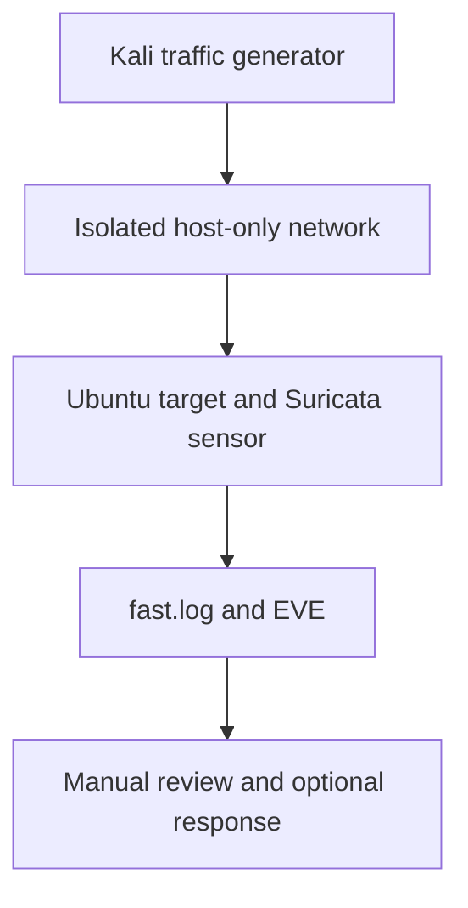

# Network intrusion detection with Suricata

## Objective
Observe traffic sent to a monitored Linux lab target, apply four custom rules,
and practice alert review with an optional manual response. An alert is a rule
match; it does not establish compromise.

## Architecture


The sensor and target are the same VM here. A separate passive sensor needs a
mirror/TAP or traffic routing through it to observe other hosts' traffic.

## Environment
| Component | Status |
| --- | --- |
| Intended lab | Ubuntu/Debian target, Kali generator, VirtualBox |
| Address examples | Target 192.168.56.102; generator 192.168.56.103; replace with actual addresses |
| Cleanup validation | Ubuntu 24.04.3 LTS; Bash syntax checked |
| Suricata and VirtualBox versions | TODO: record on the actual lab; neither was run during cleanup |

## Setup
Prepare two VMs with NAT for package installation and the **same host-only**
network for test traffic. Keep tests on that interface. On the target VM:

```bash
sudo apt-get update
sudo apt-get install -y git suricata
git clone https://github.com/mdalamin-infosec/Security-Labs.git
cd Security-Labs/network-intrusion-detection-suricata
ip -br -4 addr
suricata --build-info
```

Edit [configs/suricata-lab.yaml](configs/suricata-lab.yaml) so `HOME_NET`
contains the actual target address. Select the actual host-only interface below.
This is a foreground lab configuration, not a replacement for a production
service configuration. Use one Suricata capture process for this interface.

## How to run
On the target, replacing the interface example:
```bash
LAB_IFACE=enp0s8
mkdir -p outputs/live outputs/config-check
sudo suricata -T -c configs/suricata-lab.yaml -S rules/local.rules -l outputs/config-check
sudo suricata -i "$LAB_IFACE" -c configs/suricata-lab.yaml -S rules/local.rules -l outputs/live
```

In another terminal, in the same project directory:
```bash
ALERT_LOG="$PWD/outputs/live/fast.log" bash src/monitor_alerts.sh
```

Stop foreground processes with Ctrl+C. Logs remain under ignored `outputs/`.
The optional `src/response.sh` reads the latest SYN alert and asks for log-only
or UFW blocking. Its protected IDS address is hardcoded; review it before use.
Do not treat its printed success message as proof a firewall rule was applied.

## How I validated it
Cleanup checked the syntax of both shell scripts using `bash -n`.
[Validation steps](docs/VALIDATION.md) specify the exact live test cases and
evidence to retain. No live attacks, capture, block or real-engine replay was
performed during cleanup.

## Results
| Check | Recorded result |
| --- | --- |
| Shell syntax | Both scripts passed `bash -n` |
| Rule inventory | Four custom SIDs, 1000001–1000004 |
| Existing evidence | Six [screenshot files](docs/screenshots/); provenance/sanitization review remains TODO |
| Real-engine load and rule firing | TODO: test |
| Detection rate / false-positive rate | TODO: measure |

The earlier [partial report](docs/detection-report.md) is an incomplete legacy
record, not a new validated result.

## Limitations
The ICMP rule matches ordinary pings; the SSH rule sees TCP traffic, not login
failures. Port 4444 alone is not a malware indicator. The SYN rule counts packets
by source, not unique destination ports. Encrypted application contents and
off-interface traffic are unavailable. Response parsing is IPv4-specific, uses
the latest matching alert without a freshness check, and does not verify UFW's
exit status. Manual response requires a disposable authorized lab and rollback.

## MITRE ATT&CK mapping
| SID | Signal | Relationship and boundary |
| --- | --- | --- |
| 1000001 | ICMP traffic to HOME_NET | [T1018](https://attack.mitre.org/techniques/T1018/) context; an individual ping does not prove host discovery |
| 1000002 | At least 10 SYN packets within 5 seconds | [T1046](https://attack.mitre.org/techniques/T1046/) context; distinct-port scanning is not enforced |
| 1000003 | TCP traffic to port 22 | Unmapped: connection traffic does not establish brute force |
| 1000004 | TCP traffic to port 4444 | Unmapped: a port alone does not establish C2 |

## References
- [Suricata quickstart](https://docs.suricata.io/en/latest/quickstart.html)
- [VirtualBox networking](https://docs.oracle.com/en/virtualization/virtualbox/7.2/user/networkingdetails.html)
- [Local rules](rules/local.rules), [validation](docs/VALIDATION.md),
  [personal TODOs](../docs/TODO.md), [interview questions](../docs/INTERVIEW_QUESTIONS.md).
