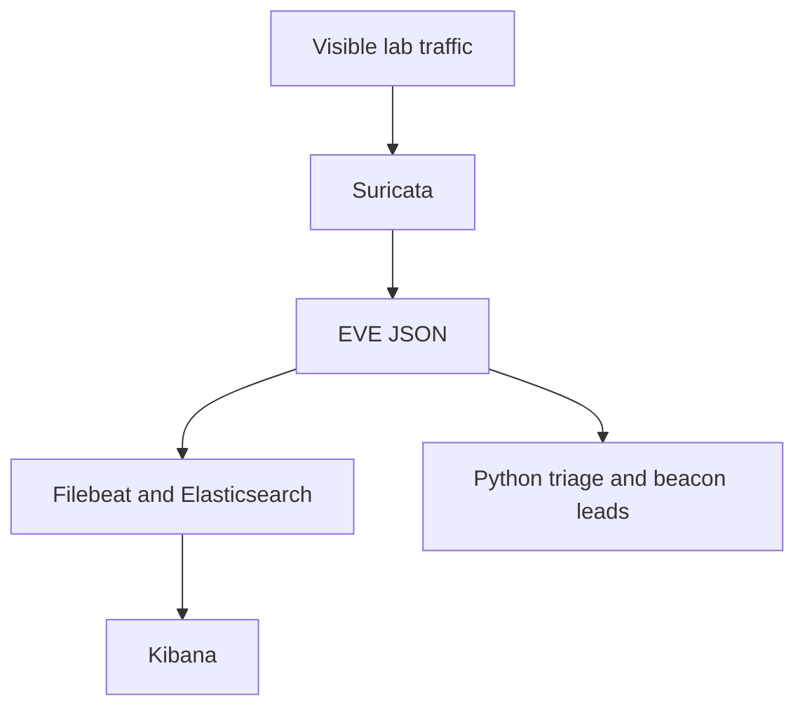

# Suricata and Elastic Stack threat triage

## Objective
Build a lab pipeline from network alerts to searchable events and explainable
incident grouping. The Python analyst tooling also runs offline without Docker.

## Architecture


## Environment
| Component | Recorded status |
| --- | --- |
| Cleanup runtime | Ubuntu 24.04.3 LTS; Python 3.12.14 |
| Python CLI | Standard library; Python 3.11 or newer; install the local package |
| Declared live stack | Elastic/Filebeat/Kibana 8.15.3; Suricata 7.0.7 |
| Docker/live stack | Not run here; version support and compatibility remain TODO |
| Evidence | [32-test run](docs/validation-run.txt); [installed-wheel check](../docs/packaging-run.txt) |

The image tags are inherited lab pins, not a recommendation of their current
support/security status. Review and test version changes before live use.

## Setup
```bash
git clone https://github.com/mdalamin-infosec/Security-Labs.git
cd Security-Labs/realtime-threat-detection-elk
python3 -m venv .venv
. .venv/bin/activate
python -m pip install -e .
```

## How to run
Offline synthetic demo:
```bash
python -m threatwatch demo --data-dir outputs/demo-data --report-dir outputs/demo-reports
python -m threatwatch rules
```

For your own sanitized EVE file:
```bash
python -m threatwatch triage path/to/eve.json --format markdown
python -m threatwatch beacons path/to/eve.json
```

Optional live Linux lab stack: install Docker Engine and the Compose plugin
using [Docker's instructions](https://docs.docker.com/engine/install/). Find the
actual capture interface with `ip -br link`, then set `SURICATA_IFACE` in the
local file copied below. The sensor sees that interface's traffic only.

```bash
cp configs/.env.example configs/.env
# Edit configs/.env before starting the stack.
docker compose --env-file configs/.env -f configs/docker-compose.yml up -d
python scripts/setup_kibana.py
```

Open [Kibana](http://127.0.0.1:5601). Live ingestion, event timestamps and dashboard
creation remain TODO: test. Stop the stack with the same Compose flags and
`down`; omit `--volumes` when retaining investigation data.
See [Kibana guidance](docs/KIBANA_GUIDE.md).

## How I validated it
```bash
python -m unittest discover -s tests -v
```
The retained run contains 32 passing tests for parsing, rule metadata, grouping,
priority, beacon heuristics, metric arithmetic and CLI behavior. Both built
Python wheels were also installed in a separate environment and used from
outside this repository; the eight-rule catalogue remained available.

[The exact synthetic cases](sample-data/cases.json) describe the PCAP generator.
To test the actual engine on a suitable host:
```bash
python -m pip install -r ../sigma-suricata-detection-rules/requirements-pcap.txt
bash tests/pcap/run_suricata_pcap.sh
```
This retains PCAP/config/EVE/build-info/log files under `outputs/replay.*`.
It requires all eight SIDs and no alert for the benign DNS control. It is not a
performance benchmark. See [validation](docs/VALIDATION.md).

## Results
| Check | Recorded result |
| --- | --- |
| Unit tests | 32 passed |
| Synthetic offline CLI | 21 synthetic alerts grouped into 5 incidents, with 1 beacon lead |
| Installed package | Packaged rule catalogue and offline CLI worked outside the checkout |
| PCAP generation | Blocked here by a Scapy netlink-socket permission error |
| Suricata replay / Compose / live Kibana | TODO: test |
| Detection quality / time saved | TODO: measure |

## Limitations
The synthetic demo does not establish real malicious activity. Grouping and
priority are heuristics; metadata-derived tactic labels are not verified attack
sequences. Encrypted payloads are unavailable. SYN thresholds do not identify
failed authentications or distinct-port scans. Long DNS labels have benign uses.
The lab Compose stack disables authentication and binds exposed services to
loopback. It uses Linux host networking for capture. No production hardening or
Atomic Red Team execution is evidenced.

## MITRE ATT&CK mapping
These are contextual mappings carried by rule metadata, not complete detections.

| SID | Signal | Mapping and boundary |
| --- | --- | --- |
| 9000001 | SSH SYN burst | [T1110](https://attack.mitre.org/techniques/T1110/) candidate context; requires authentication logs |
| 9000002 | SYN burst | [T1046](https://attack.mitre.org/techniques/T1046/) context; rule does not count unique ports |
| 9000003 | ICMP echo burst | [T1018](https://attack.mitre.org/techniques/T1018/) context |
| 9000004 | Scanner user-agent | [T1595](https://attack.mitre.org/techniques/T1595/) context; user-agent is spoofable |
| 9000005 | Cleartext Basic header | [T1040](https://attack.mitre.org/techniques/T1040/) exposure context; no sniffing adversary is proven |
| 9000006 | Long DNS label | [T1071.004](https://attack.mitre.org/techniques/T1071/004/) candidate context; no C2 proof |
| 9000007 | Traversal-like URI | [T1190](https://attack.mitre.org/techniques/T1190/) context; no successful exploit is proven |
| 9000008 | Telnet connection | [T1021](https://attack.mitre.org/techniques/T1021/) context; authorized remote use also matches |

## References
- [Suricata](https://docs.suricata.io/), [Elastic documentation](https://www.elastic.co/docs).
- [Rule source](src/threatwatch/data/local.rules), [playbooks](docs/INCIDENT_RESPONSE_PLAYBOOK.md),
  [measurement procedure](docs/METRICS.md).
- [Personal TODOs](../docs/TODO.md) and [interview questions](../docs/INTERVIEW_QUESTIONS.md).
