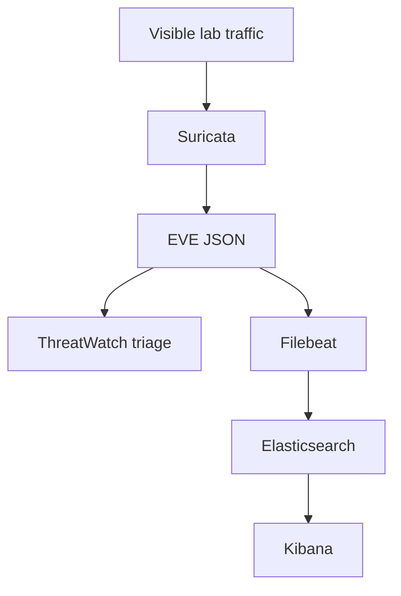

# Suricata and Elastic Stack threat triage

## Objective

Build an explainable SOC-style workflow from network alerts to grouped incidents, ATT&CK context, playbooks and lifecycle measurement. The Python analyst tooling runs offline; the full Elastic/Kibana pipeline remains a separate operational validation target.

## Architecture



## Current validated evidence

| Check | Result |
| --- | --- |
| Unit tests | 32 passed |
| Synthetic demo | 21 alerts → 5 incidents; 2 P1 incidents; 1 beacon lead |
| Owner lifecycle cohorts | 5 before-playbook + 5 with-playbook |
| Median triage change | 0.0% in the small replay |
| Median close change | -33.3% in the small replay |
| Full live Elastic/Kibana pipeline | Not yet retained as owner-run evidence |

The timing cohort uses second-scale replay interactions and is intentionally **not** presented as a general analyst-productivity result.

## Offline use

```bash
python -m threatwatch demo --data-dir outputs/demo-data --report-dir outputs/demo-reports
python -m threatwatch rules
python -m threatwatch triage path/to/eve.json --format markdown
python -m threatwatch beacons path/to/eve.json
```

Lifecycle metrics:

```bash
python -m threatwatch metrics records.csv --baseline before-playbook --treatment with-playbook
```

## Optional Elastic/Kibana lab

The repository includes Compose, Filebeat and Kibana setup material. Treat it as a lab path that still requires an owner-retained end-to-end run with current compatible image versions.

See [LIVE_PIPELINE_VALIDATION.md](docs/LIVE_PIPELINE_VALIDATION.md) for the exact next evidence target.

## Limitations

- Synthetic incident grouping does not establish production alert quality.
- Beacon heuristics generate leads, not verdicts.
- The small timing exercise is not a productivity benchmark.
- Full Suricata → Filebeat → Elasticsearch → Kibana operational evidence is still pending.

See [validation](docs/VALIDATION.md), [metrics](docs/METRICS.md), and the root [roadmap](../docs/ROADMAP.md).
