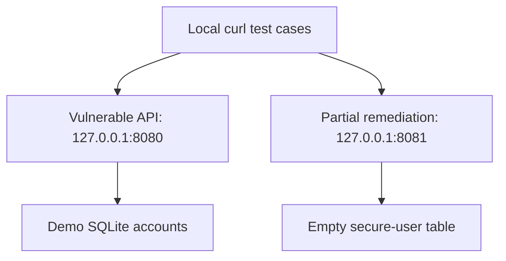

# Secure code review: Rust web APIs

## Objective
Compare a deliberately vulnerable Actix-web/SQLite application with a partially
remediated counterpart. Review application-level security despite memory-safe
Rust. No CVE discovery or production security certification is claimed.

## Architecture


## Environment
| Component | Status |
| --- | --- |
| Intended host | Debian/Ubuntu Linux; Linux `ping` arguments are used |
| Rust/Cargo/Clippy | TODO: record versions and run; unavailable in the cleanup runtime |
| Dependency versions | Locked separately in each application's committed `Cargo.lock` |
| Source review | Static inspection only; both original `main.rs` files were preserved |

## Setup
```bash
sudo apt-get update
sudo apt-get install -y git curl build-essential pkg-config libssl-dev iputils-ping
git clone https://github.com/mdalamin-infosec/Security-Labs.git
cd Security-Labs/secure-code-review
```
Install Rust/Cargo with [official rustup instructions](https://rust-lang.org/tools/install/),
then load the toolchain and add Clippy:
```bash
. "$HOME/.cargo/env"
rustup component add clippy
rustc -Vv
cargo --version
```

## How to run
Terminal A, from this project directory:
```bash
cd src/vulnerable-app
cargo run --locked
```

Terminal B, from this project directory:
```bash
cd src/secure-app
APP_SECRET=local-demo-only cargo run --locked
```
Databases are created relative to the process working directory. Both apps bind
to loopback. Stop them with Ctrl+C. The environment secret is read but does not
implement sessions/authentication; a development fallback also remains.

## How I validated it
Cleanup compared the preserved source paths and reviewed the SQL and subprocess
sinks. Compilation, Clippy and endpoint behavior are **TODO: test**, not passed.
Run the following on the actual Linux lab:

```bash
cargo check --locked --manifest-path src/vulnerable-app/Cargo.toml
cargo check --locked --manifest-path src/secure-app/Cargo.toml
cargo clippy --locked --manifest-path src/vulnerable-app/Cargo.toml
cargo clippy --locked --manifest-path src/secure-app/Cargo.toml
```

[The exact endpoint cases](docs/VALIDATION.md) cover health, disclosure, SQL
injection, invalid IPs and controlled shell-input handling. Record real HTTP
responses and exit status before claiming a demonstrated remediation.

## Results
| Source-supported observation | Evidence |
| --- | --- |
| SQL string interpolation changed to parameter binding | [Two source trees](src/) |
| Shell command construction changed to IP parsing and direct `ping` arguments | [Review](docs/security-review.md) |
| Password response field removed; Argon2 verification added | Source comparison; hash provisioning absent |
| Successful build, lint and endpoint regression | TODO: test |
| Successful login against the remediated app | TODO: implement and test synthetic Argon2 user provisioning |
| Complete security remediation | Not established; the limitations below remain |

## Limitations
The remediated demo still sends credentials in GET query strings. `/user` lacks
authentication/authorization. No enrollment, seeded hash, session management or
rate limiting exists. Valid arbitrary IPs remain accepted by `/ping`.
`APP_SECRET` is unused in an authentication mechanism and has a placeholder
fallback. Startup database failures can still terminate the program. These
weaknesses make the application a learning exercise, not a deployable login
service. Deliberately weak accounts in the vulnerable version are demo-only.

## MITRE ATT&CK mapping
CWE identifies weaknesses more directly; ATT&CK below is possible attacker
behavior, not an observed campaign or a claim of executed tests.

| Reviewed issue | CWE | Contextual ATT&CK |
| --- | --- | --- |
| SQL interpolation in an exposed application | CWE-89 | [T1190](https://attack.mitre.org/techniques/T1190/) if deployed publicly; these demos are loopback-only |
| Shell execution with request input | CWE-78 | [T1059.004](https://attack.mitre.org/techniques/T1059/004/) |
| Embedded demo secret in source | CWE-798 | [T1552.001](https://attack.mitre.org/techniques/T1552/001/) source-file exposure context |
| Missing authorization / GET credentials | CWE-862 / CWE-598 | No direct technique asserted from the weakness alone |

## References
- [Cargo book](https://doc.rust-lang.org/cargo/).
- [Actix-web](https://actix.rs/), [rusqlite](https://docs.rs/rusqlite/), [Argon2 crate](https://docs.rs/argon2/).
- [MITRE CWE](https://cwe.mitre.org/), [static review](docs/security-review.md),
  [personal TODOs](../docs/TODO.md), [interview questions](../docs/INTERVIEW_QUESTIONS.md).
