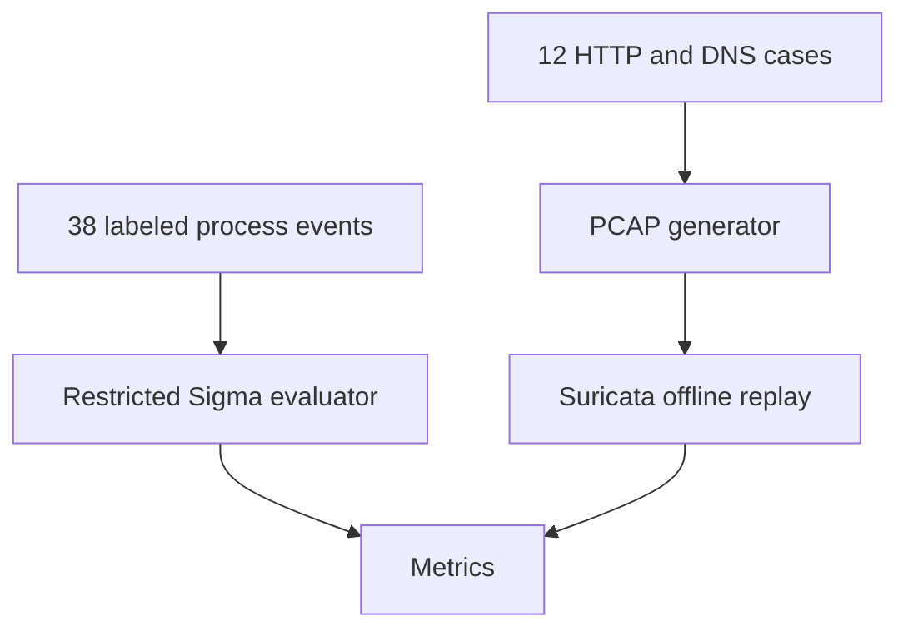

# Sigma and Suricata detection rules

## Objective

Practice detection engineering with 15 Sigma process-creation rules, eight Suricata signatures, synthetic fixtures, and an actual offline Suricata replay. The project reports fixture/replay quality separately from operational efficacy.

## Architecture



## Current validated evidence

| Check | Result |
| --- | --- |
| Unit tests | 4 passed |
| Sigma synthetic corpus | 20/20 attack fixtures detected; 18 benign fixtures evaluated |
| Synthetic FP tuning | Baseline FP 3 → tuned FP 0 on the bundled fixture corpus |
| Suricata replay | 8/8 attack PCAPs detected |
| Benign Suricata controls | 0/4 false positives |
| Independent held-out operational dataset | Not yet measured |

The Suricata replay is a real-engine test against synthetic PCAPs. The percentages above are not production detection rates.

## Setup

```bash
git clone https://github.com/mdalamin-infosec/Security-Labs.git
cd Security-Labs/sigma-suricata-detection-rules
python3 -m venv .venv
. .venv/bin/activate
python -m pip install -r requirements.txt
```

## Run the Sigma fixture evaluator

```bash
python tools/evaluate_sigma.py --output outputs/sigma-metrics.json
```

The 38 cases in `sample-data/sigma_events.jsonl` are hand-authored fixtures: 20 attack-labeled and 18 benign. They were designed with the rules and therefore are not held-out evidence.

## Run the actual Suricata replay

```bash
sudo apt-get update
sudo apt-get install -y suricata
python -m pip install -r requirements-pcap.txt
python tools/generate_pcaps.py
python tools/replay_suricata.py --config configs/suricata-lab.yaml
```

The replay reads local PCAPs and sends no traffic. It performs a Suricata configuration test before replay and retains engine output under ignored `outputs/` paths.

## Limitations

- Full Sigma conversion and execution in an Elastic/Splunk backend remains a next step.
- The fixture corpus is not independent held-out telemetry.
- Command-line indicators can be evaded or triggered by legitimate administration.
- HTTPS payloads are not visible to plaintext HTTP signatures without decryption/termination elsewhere.
- ATT&CK mappings provide behavioral context, not proof of compromise.

See [validation](docs/VALIDATION.md), [held-out evaluation protocol](docs/HELD_OUT_EVALUATION.md), and the root [roadmap](../docs/ROADMAP.md).
