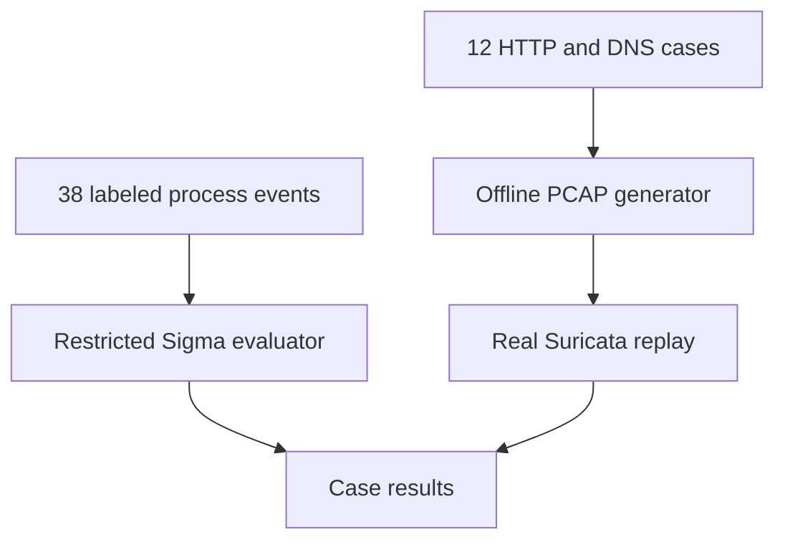

# Sigma and Suricata detection rules

## Objective
Practice detection engineering with 15 Sigma process-creation rules, eight
Suricata signatures, and explicitly synthetic test inputs. Operational detection
quality is **TODO: measure**.

## Architecture


## Environment
| Component | Recorded status |
| --- | --- |
| Cleanup runtime | Ubuntu 24.04.3 LTS; Python 3.12.14; PyYAML 6.0.3 |
| Intended host | Debian/Ubuntu Linux; Python 3.11 or newer |
| Optional PCAP dependency | Scapy 2.8.0 installed during cleanup; import was blocked by this runtime's socket permissions |
| Suricata | Not installed in the cleanup runtime; TODO: record actual engine build |
| Actual run evidence | [Unit-test output](docs/validation-run.txt) |

## Setup
```bash
git clone https://github.com/mdalamin-infosec/Security-Labs.git
cd Security-Labs/sigma-suricata-detection-rules
python3 -m venv .venv
. .venv/bin/activate
python -m pip install -r requirements.txt
```

## How to run
```bash
python tools/evaluate_sigma.py --output outputs/sigma-metrics.json
```
This evaluates [38 hand-authored synthetic cases](sample-data/sigma_events.jsonl):
20 labeled attack and 18 benign. Its percentages describe those fixtures only.
The baseline intentionally omits the example parent-process suppressions; it is
not an independent production baseline.

Optional real-engine replay, from the same project directory:
```bash
sudo apt-get update
sudo apt-get install -y suricata
python -m pip install -r requirements-pcap.txt
python tools/generate_pcaps.py
python tools/replay_suricata.py --config configs/suricata-lab.yaml
```
The supplied [configuration](configs/suricata-lab.yaml) is for offline fixtures
using `192.168.1.0/24` and `198.51.100.0/24`. It references packaged Suricata
classification/reference files. This replay reads PCAPs; it sends no traffic.
It retains actual engine output in a new ignored `outputs/suricata-replay-*`
directory and writes `outputs/suricata_metrics.json`.

## How I validated it
Automated cleanup run:
```bash
python -m unittest discover -s tests -v
```
Four test methods check rule IDs/structure, all 38 fixture expectations, signature
metadata and metric arithmetic. [Validation details](docs/VALIDATION.md) identify
the exact case set. Full Sigma conversion and SIEM execution remain TODO; the
Python evaluator implements only a limited subset of Sigma.

## Results
| Check | Recorded result |
| --- | --- |
| Python suite | 4 tests passed; see the retained run output |
| Synthetic Sigma inputs | All 38 fixture expectations passed |
| Actual Suricata replay | TODO: test on a host with the engine; PCAP generation was blocked here by a Scapy socket-permission error |
| Operational recall, precision, false-positive reduction | TODO: measure on independent labeled traffic |

## Limitations
The fixtures were written alongside the rules. They cannot establish real-world
efficacy. Command-line signals can be evaded or triggered by legitimate activity.
Parent-process exclusions can hide malicious execution. HTTPS payloads are not
available to these plaintext HTTP signatures. The `.invalid` DNS suffix is a
laboratory indicator, not a real threat IOC. No Atomic Red Team tests were run.

## MITRE ATT&CK mapping
Mappings describe possible behavior associated with a signal, not confirmed
compromise or complete technique coverage.

| Rule file under [rules/sigma](rules/sigma/) | ATT&CK |
| --- | --- |
| `windows/win_powershell_encoded_command.yml`; `windows/win_powershell_web_download.yml` | [T1059.001](https://attack.mitre.org/techniques/T1059/001/) |
| `windows/win_certutil_urlcache_download.yml` | [T1105](https://attack.mitre.org/techniques/T1105/) |
| `windows/win_bitsadmin_file_transfer.yml` | [T1197](https://attack.mitre.org/techniques/T1197/) |
| `windows/win_mshta_remote_content.yml` | [T1218.005](https://attack.mitre.org/techniques/T1218/005/) |
| `windows/win_regsvr32_scrobj.yml` | [T1218.010](https://attack.mitre.org/techniques/T1218/010/) |
| `windows/win_installutil_logfile_bypass.yml` | [T1218.004](https://attack.mitre.org/techniques/T1218/004/) |
| `windows/win_rundll32_comsvcs_dump.yml` | [T1003.001](https://attack.mitre.org/techniques/T1003/001/) |
| `windows/win_schtasks_create.yml` | [T1053.005](https://attack.mitre.org/techniques/T1053/005/) |
| `windows/win_vssadmin_delete_shadows.yml` | [T1490](https://attack.mitre.org/techniques/T1490/) |
| `windows/win_wmic_process_create.yml` | [T1047](https://attack.mitre.org/techniques/T1047/) |
| `windows/win_local_admin_group_add.yml` | [T1098](https://attack.mitre.org/techniques/T1098/) |
| `windows/win_wevtutil_clear_logs.yml` | [T1070.001](https://attack.mitre.org/techniques/T1070/001/) |
| `linux/lnx_curl_piped_shell.yml` | [T1059.004](https://attack.mitre.org/techniques/T1059/004/) |
| `linux/lnx_chmod_world_writable.yml` | [T1222.002](https://attack.mitre.org/techniques/T1222/002/) |
| Suricata SIDs 4200001–4200005, 4200007: suspicious web probes | [T1190](https://attack.mitre.org/techniques/T1190/), contextual only |
| Suricata SID 4200006: scanner user-agent | [T1595](https://attack.mitre.org/techniques/T1595/), contextual only |
| Suricata SID 4200008: reserved lab DNS suffix | [T1071.004](https://attack.mitre.org/techniques/T1071/004/), simulation only |

## References
- [Sigma specification and tooling](https://sigmahq.io/docs/)
- [pySigma upstream](https://github.com/SigmaHQ/pySigma) — install a compatible backend; source is not vendored here.
- [Suricata documentation](https://docs.suricata.io/)
- [Outstanding personal checks](../docs/TODO.md) and [interview questions](../docs/INTERVIEW_QUESTIONS.md).
